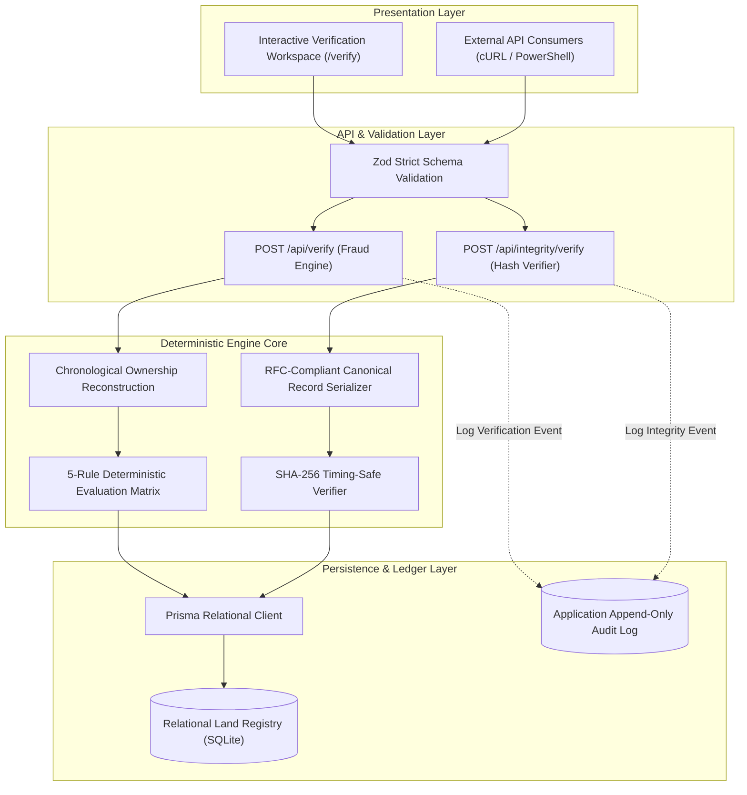
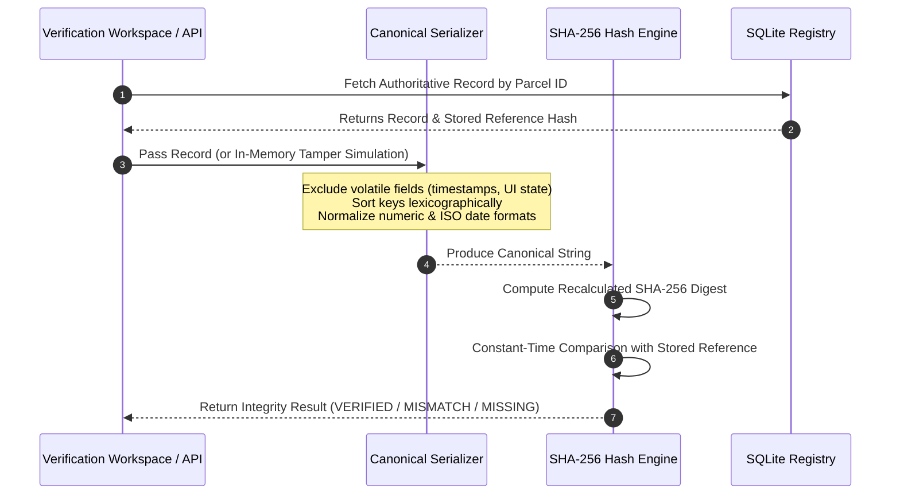

# LandGuard 🛡️
> **LandTech 2026 Hackathon — Track P3: Fraud & Double-Selling Detection**  
> *Enterprise Cryptographic Land Registry Verification & Pre-Transaction Fraud Prevention Platform*

[](https://guard-initial.vercel.app)
[](https://guard-initial.vercel.app/verify)
[](https://www.typescriptlang.org/)
[-000000?style=for-the-badge&logo=nextdotjs&logoColor=white)](https://nextjs.org/)
[](https://www.prisma.io/)
[](https://nodejs.org/api/crypto.html)
[](https://vitest.dev/)

---

## 🌐 Live System Endpoints

| Environment | Purpose | URL |
| :--- | :--- | :--- |
| **Production Web UI** | Executive landing page and system status board | [https://guard-initial.vercel.app](https://guard-initial.vercel.app) |
| **Interactive Workspace** | Dual-mode verification console (Fraud + Cryptographic Integrity) | [https://guard-initial.vercel.app/verify](https://guard-initial.vercel.app/verify) |
| **Verification API** | Deterministic pre-transaction fraud evaluation endpoint | `POST https://guard-initial.vercel.app/api/verify` |
| **Integrity API** | Canonical SHA-256 digest validation & tamper detection endpoint | `POST https://guard-initial.vercel.app/api/integrity/verify` |
| **GitHub Repository** | Source code, test suites, database migrations, and docs | [https://github.com/ishruq1317/Guard_Initial](https://github.com/ishruq1317/Guard_Initial) |

---

## 📋 Executive Summary & Problem Statement

Land title fraud, duplicate sales, and deed tampering represent severe systemic vulnerabilities in real-estate registries globally. In standard administrative environments, a critical latency window exists between deed execution at a sub-registry office and subsequent record-of-rights (khatian) mutation at a revenue circle office. Fraudulent actors exploit this window by:

1. **Double-Selling:** Executing simultaneous deed conveyances with multiple prospective buyers before any transfer is formally indexed.
2. **Owner Identity Impersonation:** Presenting expired or forged documents claiming current legal title when records indicate a historical transfer already occurred.
3. **Registration–Mutation Discrepancies:** Exploiting disconnected municipal registration deeds that were rejected or never submitted for revenue mutation.
4. **Retrospective Deed Tampering:** Modifying parcel boundaries, square footage, or ownership identifiers in storage records without an auditable cryptographic baseline.

**LandGuard** resolves these vulnerabilities through a **dual-pillar architecture**:
- **Pillar 1: Deterministic Multi-Rule Pre-Transaction Verification Engine** that reconstructs legal title ownership chains and halts conflicting transactions prior to execution.
- **Pillar 2: Cryptographic Canonical Record Integrity Pipeline** using deterministic SHA-256 hashing to verify record fidelity and detect unauthorized data modifications bit-by-bit.

---

## 🏛️ System Architecture

LandGuard is designed as a zero-trust, stateless decision-support verification layer built upon Next.js 15, Prisma ORM, and Node.js Cryptography.



---

## ⚙️ Core Technology Stack

| Layer | Technology | Engineering Role |
| :--- | :--- | :--- |
| **Framework** | **Next.js 15.3 (App Router)** | Modern server components, client interactivity, edge-ready API routes |
| **Language** | **TypeScript 5 (Strict Mode)** | End-to-end type safety across domain logic, schemas, and API contracts |
| **Styling** | **Tailwind CSS 3.4** | High-contrast, responsive visual identity (Dark Navy `#0B132B` & Emerald `#059669`) |
| **Data Layer** | **Prisma 5.22 + SQLite** | Relational parcel models, deeds, mutations, mortgages, and audit logs |
| **Validation** | **Zod 3.24** | Strict runtime schema enforcement rejecting malformed payloads |
| **Cryptography** | **Node.js `crypto`** | Deterministic SHA-256 canonical hashing & `timingSafeEqual` digest verification |
| **Quality Assurance** | **Vitest 2.1** | 33 isolated unit, engine, cryptographic, and API integration test suites |
| **Deployment** | **Vercel Serverless** | Global edge distribution with isolated `/tmp` write-layer database resilience |

---

## 🛡️ Verification Engine: 5 Deterministic Fraud Rules

LandGuard evaluates proposed land transactions against five deterministic, explainable rules. Every rule returns structured findings with severity, statutory rationale, and cryptographic evidence references:

| Rule Code | Rule Title | Severity | Trigger Condition | Statutory / Operational Rationale |
| :--- | :--- | :--- | :--- | :--- |
| `LG-RULE-001-DOUBLE-SELLING` | **Double-Selling Conflict** | 🚨 **CRITICAL** | Proposed seller already conveyed the parcel in a prior recorded transaction. | Prevents duplicate conveyances; title has already been transferred to an existing buyer. |
| `LG-RULE-002-SELLER-MISMATCH` | **Seller Mismatch** | 🚨 **CRITICAL** | Proposed seller's National ID or Legal Name does not match reconstructed title owner. | Prevents unauthorized conveyance by impostors or non-owners. |
| `LG-RULE-003-UNRECORDED-MORTGAGE` | **Active Encumbrance / Mortgage** | ⚠️ **HIGH** | Parcel has an active bank mortgage or court lien without recorded discharge. | Protects buyer from assuming undisclosed institutional liabilities or liens. |
| `LG-RULE-004-REG-MUTATION-MISMATCH` | **Registration–Mutation Discrepancy** | ⚠️ **MEDIUM** | Sub-registry deed exists, but revenue mutation application is missing, pending, or rejected. | Enforces administrative synchrony between Registration Department and Revenue Circle. |
| `LG-RULE-005-RAPID-SUCCESSION-TRANSFER` | **Rapid Succession Turnover** | ℹ️ **INFO** | Parcel transferred multiple times within a 90-day rolling window. | Identifies speculative flipping or rapid title manipulation for heightened scrutiny. |

### Outcome Verdict Categories

- 🟢 **`CLEAR`**: Transaction is consistent with all historical records, verified ownership chain, and active mutation status.
- 🔴 **`CONFLICT_DETECTED`**: Fatal legal contradiction detected (`LG-RULE-001` or `LG-RULE-002`). Conveyance must be blocked.
- 🟡 **`REVIEW_REQUIRED`**: Administrative or institutional discrepancy identified (`LG-RULE-003` or `LG-RULE-004`). Escrow or manual adjudication required.

---

## 🔐 Cryptographic Integrity & Tamper Pipeline

LandGuard enforces immutable record provenance through a documented canonicalization and hashing workflow:



### Deterministic Integrity Verification States

1. **`INTEGRITY_VERIFIED`** (`isMatch: true`):  
   The recalculated SHA-256 digest matches the stored reference hash bit-for-bit. Proves the data has not been modified since registration.
2. **`INTEGRITY_MISMATCH`** (`isMatch: false`):  
   The recalculated hash diverges from the stored baseline. The engine isolates and highlights the exact tampered fields without altering persistent storage.
3. **`REFERENCE_MISSING`** (`storedReferenceHash: null`):  
   The record exists in legacy storage but lacks a trusted reference baseline hash. Explicitly flagged for re-indexing.

---

## 🎯 Live Demonstration Guide for Judges

Judges can execute all verification workflows directly via the **Live Web Interface** or through automated **PowerShell / cURL CLI commands**.

### Part 1: Interactive Web Workspace

Navigate to **[https://guard-initial.vercel.app/verify](https://guard-initial.vercel.app/verify)**:

#### 1. Fraud & Double-Selling Workspace (Tab 1)
- **Scenario A: Consistent Legitimate Transaction**
  - Click the **"Scenario A: Legitimate Transaction"** quick-card.
  - Form populates with parcel `SYN-PARCEL-101-CLEAN` and verified owner `Bina Chowdhury`.
  - Click **"Verify Transaction via Engine"**.
  - **Result:** 🟢 **VERIFICATION CLEAR** verdict, zero conflicts, and complete reconstructed ownership provenance chain.
- **Scenario B: Double-Selling Conflict Attempt**
  - Click the **"Scenario B: Double-Selling Attempt"** quick-card.
  - Form populates with parcel `SYN-PARCEL-102-DBL` where `Farhan Kabir` attempts to sell a parcel he already conveyed.
  - Click **"Verify Transaction via Engine"**.
  - **Result:** 🔴 **FATAL CONFLICT DETECTED** citing `LG-RULE-001-DOUBLE-SELLING` and `LG-RULE-002-SELLER-MISMATCH` with deed evidence references.
- **Scenario C: Registration–Mutation Discrepancy**
  - Click the **"Scenario C: Registration–Mutation Mismatch"** quick-card.
  - Form populates with parcel `SYN-PARCEL-104-REGMUT` where seller `Monira Begum` holds a deed with a rejected revenue mutation.
  - Click **"Verify Transaction via Engine"**.
  - **Result:** 🟡 **INSTITUTIONAL REVIEW REQUIRED** citing `LG-RULE-004-REG-MUTATION-MISMATCH`.

#### 2. Cryptographic Record Integrity Workspace (Tab 2)
- Click the **"Cryptographic Integrity"** tab in the top-right pill switcher.
- **Scenario A: Authentic Record Verification**:
  - Click **"Scenario A: Authentic Record"** &rarr; Click **"Verify Cryptographic Integrity"**.
  - **Result:** 🟢 **INTEGRITY VERIFIED** — Recalculated SHA-256 digest matches stored reference bit-for-bit.
- **Scenario B: Controlled Tamper Simulation**:
  - Click **"Scenario B: Controlled Tamper Simulation"** &rarr; Click **"Verify Cryptographic Integrity"**.
  - **Result:** 🔴 **INTEGRITY MISMATCH DETECTED** — Digest divergence displayed; modified fields (`ownerNationalId`, `areaSqFt`) highlighted in red. Authoritative database remains completely untampered.
- **Scenario C: Missing Reference Hash**:
  - Click **"Scenario C: Missing Reference Hash"** &rarr; Click **"Verify Cryptographic Integrity"**.
  - **Result:** 🟡 **REFERENCE HASH MISSING** — Demonstrates graceful handling of unindexed legacy records.

---

### Part 2: Automated CLI / API Verification

All endpoints are live and callable globally. Execute these commands in **PowerShell** or **Bash**:

#### 1. Legitimate Transaction (`CLEAR`)
```powershell
Invoke-RestMethod -Uri "https://guard-initial.vercel.app/api/verify" -Method POST -ContentType "application/json" -Body '{
  "transactionReference": "TXN-DEMO-LEGIT-001",
  "parcelId": "SYN-PARCEL-101-CLEAN",
  "sellerName": "Bina Chowdhury",
  "sellerId": "SYN-NID-1002",
  "buyerName": "Chandan Sen",
  "buyerId": "SYN-NID-1003",
  "amount": 1200000,
  "transactionDate": "2026-06-01T09:00:00Z"
}'
```

#### 2. Double-Selling Attempt (`CONFLICT_DETECTED`)
```powershell
Invoke-RestMethod -Uri "https://guard-initial.vercel.app/api/verify" -Method POST -ContentType "application/json" -Body '{
  "transactionReference": "TXN-DEMO-DOUBLE-SELL",
  "parcelId": "SYN-PARCEL-102-DBL",
  "sellerName": "Farhan Kabir",
  "sellerId": "SYN-NID-2001",
  "buyerName": "Habibur Rahman",
  "buyerId": "SYN-NID-2003",
  "amount": 1800000,
  "transactionDate": "2026-07-15T14:00:00Z"
}'
```

#### 3. Registration–Mutation Mismatch (`REVIEW_REQUIRED`)
```powershell
Invoke-RestMethod -Uri "https://guard-initial.vercel.app/api/verify" -Method POST -ContentType "application/json" -Body '{
  "transactionReference": "TXN-DEMO-C-REGMUT",
  "parcelId": "SYN-PARCEL-104-REGMUT",
  "sellerName": "Monira Begum",
  "sellerId": "SYN-NID-4002",
  "buyerName": "Nafis Iqbal",
  "buyerId": "SYN-NID-4003",
  "amount": 2500000,
  "transactionDate": "2026-08-10T11:00:00Z"
}'
```

#### 4. Cryptographic Authentic Record (`INTEGRITY_VERIFIED`)
```powershell
Invoke-RestMethod -Uri "https://guard-initial.vercel.app/api/integrity/verify" -Method POST -ContentType "application/json" -Body '{
  "parcelId": "SYN-PARCEL-101-CLEAN"
}'
```

#### 5. Cryptographic Controlled Tamper (`INTEGRITY_MISMATCH`)
```powershell
Invoke-RestMethod -Uri "https://guard-initial.vercel.app/api/integrity/verify" -Method POST -ContentType "application/json" -Body '{
  "parcelId": "SYN-PARCEL-101-CLEAN",
  "simulateTamper": {
    "ownerNationalId": "SYN-NID-TAMPERED-9999",
    "areaSqFt": 99999
  }
}'
```

---

## 🔒 Security Trust Boundaries & Threat Model

To maintain rigorous engineering honesty for hackathon evaluation:

1. **Colocated Storage Trust Boundary:**
   - In this prototype demonstration, both the land records and the reference SHA-256 hashes reside within the relational SQLite database.
   - *Threat Model Reality:* An adversary with direct, privileged administrative write access to the SQLite file could simultaneously alter a record and recompute its reference hash.
   - *Production Countermeasure:* In an enterprise deployment, reference hashes and deed fingerprints should be published to external hardware trust roots (HSM/KMS), signed using public-key cryptography (Ed25519), or committed to a verifiable append-only transparency log (RFC 6962).
2. **Audit Log Non-Repudiation:**
   - The application enforces append-only logging to the `AuditLog` table on verification events.
   - *Limitation:* SQLite does not cryptographically enforce immutability at the file system level. True non-repudiation requires external WORM (Write Once, Read Many) cloud storage or SIEM integration.
3. **Legal Decision-Support Boundary:**
   - LandGuard is a pre-transaction decision-support and conflict-detection platform.
   - A `CLEAR` verification status certifies algorithmic and chronological consistency across recorded evidence; it does not constitute a statutory state guarantee of title or replace judicial adjudication.

---

## 🧪 Testing & Verification Quality Matrix

The LandGuard test suite contains **33 automated test specs** across 4 dedicated suites:

```bash
# Execute complete Vitest test suite
npm run test
```

```text
 ✓ src/lib/__tests__/crypto.test.ts (9 tests)
   ✓ deterministic SHA-256 hashing across key ordering
   ✓ canonical representation consistency
   ✓ timing-safe digest comparison
   ✓ non-record metadata exclusion

 ✓ src/lib/engine/__tests__/rules.test.ts (11 tests)
   ✓ LG-RULE-001: double-selling detection
   ✓ LG-RULE-002: seller mismatch detection
   ✓ LG-RULE-003: active mortgage encumbrance flag
   ✓ LG-RULE-004: registration-mutation discrepancy flag
   ✓ LG-RULE-005: rapid succession turnover advisory
   ✓ combined multi-finding priority sorting

 ✓ src/lib/engine/__tests__/reconstruct.test.ts (3 tests)
   ✓ chronological chain-of-title reconstruction
   ✓ handling parcels with zero transaction history

 ✓ src/app/api/__tests__/verify.test.ts (10 tests)
   ✓ end-to-end POST /api/verify API contract
   ✓ schema rejection on malformed inputs
   ✓ end-to-end POST /api/integrity/verify API contract
   ✓ controlled tamper simulation isolation
   ✓ missing reference hash handling

Test Files  4 passed (4)
     Tests  33 passed (33)
```

---

## 💻 Local Development Setup

### Prerequisites
- **Node.js** `v20.x` or `v24.x`
- **npm** `v10.x` or `v11.x`
- **Git**

### Installation Steps

1. **Clone Repository:**
   ```bash
   git clone https://github.com/ishruq1317/Guard_Initial.git
   cd Guard_Initial
   ```

2. **Install Dependencies:**
   ```bash
   npm install
   ```

3. **Configure Environment:**
   ```bash
   cp .env.example .env
   ```

4. **Initialize Database & Seed Demonstration Scenarios:**
   ```bash
   npm run prisma:generate
   npm run prisma:migrate
   npm run seed
   ```

5. **Start Development Server:**
   ```bash
   npm run dev
   ```
   Open [http://localhost:3000](http://localhost:3000) in your browser.

---

## ⚖️ Hackathon Compliance & Disclosures

### 1. Synthetic Demonstration Data Policy
In strict compliance with **LandTech 2026 Hackathon** rules and data ethics standards:
- **All demonstration parcels, owner names, national identity numbers, deed identifiers, and land records used in LandGuard are 100% synthetic.**
- Zero real-world citizen records, personally identifiable information (PII), or live government land registry data are stored or processed.

### 2. AI Tooling & Pair Programming Disclosure
- Architectural design, foundational schema scaffolding, and test harness authoring were pair-programmed using **Google Antigravity** powered by **Gemini** models.
- All domain rules, cryptographic integrity strategies, canonical serialization routines, and security constraints were audited and verified for production-grade hackathon execution.

---

*LandGuard — Defending Land Rights with Cryptographic Truth & Algorithmic Provenance.*
