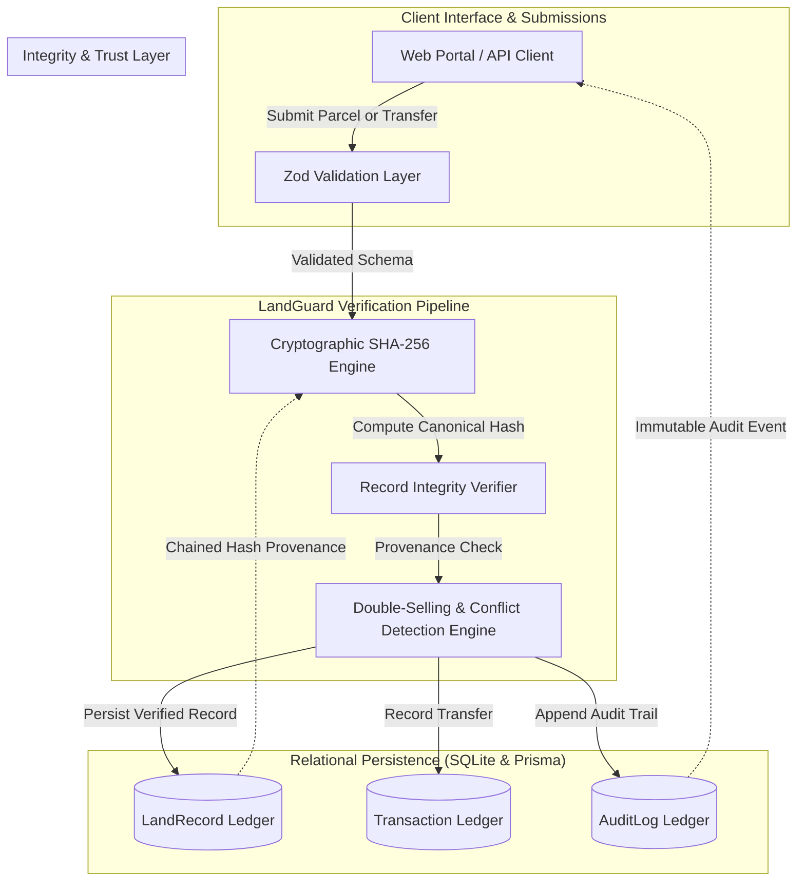
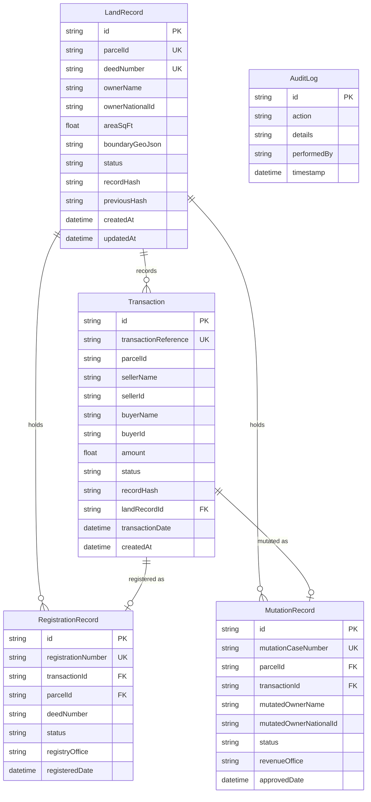

# LandGuard System Architecture & Design Specification
> **LandTech 2026 Hackathon — Track P3: Fraud & Double-Selling Detection**

---

## 1. Executive Architecture Overview

LandGuard is engineered as a zero-trust land registry integrity layer and real-time fraud prevention system. It functions as an intelligent gatekeeper between land transaction submissions and the underlying title ledger, proactively intercepting duplicate sales, conflicting boundary claims, and unauthorized alterations.

---

## 2. Core Architectural Pillars

### 2.1 Input Validation Layer (`src/lib/validations/`)
All external inputs (parcel creation, owner updates, sale transfers) must pass through strict **Zod** schemas. This guarantees:
- Sanitization against malformed identifiers and negative surface areas.
- Alphanumeric restrictions on parcel IDs and national deed records.
- Pre-validation of GeoJSON boundary payloads.

### 2.2 Cryptographic Canonicalization & Integrity Engine (`src/lib/engine/integrity.ts` & `src/lib/crypto.ts`)
To prevent undetected data tampering and guarantee reproducible digests:
- **Canonical Serialization (`canonicalizeLandRecord`):** Objects are normalized and serialized with lexicographically sorted keys (`canonicalStringify`). Dates are formatted to strict ISO-8601 UTC strings (`toISOString()`), numeric area floats are normalized to 2-decimal precision, and null/undefined values are explicitly represented as `null`.
- **Authoritative Field Extraction:** Non-record metadata (internal UUIDs, mutable status flags, updated timestamps, UI states) are strictly excluded from the canonical payload to ensure hashing only authentic deed data (`parcelId`, `deedNumber`, `ownerName`, `ownerNationalId`, `areaSqFt`, `boundaryGeoJson`, `previousHash`).
- **SHA-256 Digesting:** Node.js native `crypto.createHash('sha256')` generates a deterministic 64-character hex digest of the canonical string.
- **Constant-Time Verification:** Uses `crypto.timingSafeEqual` to avoid timing side-channel attacks during hash audits.
- **Three Explicit Integrity Statuses:**
  - `INTEGRITY_VERIFIED`: Recalculated hash strictly matches the stored reference hash.
  - `INTEGRITY_MISMATCH`: Recalculated hash diverges from the stored reference (tampering detected).
  - `REFERENCE_MISSING`: Record has no cryptographic reference hash stored in the ledger.
- **Immutability Guarantee:** Verification requests are strictly read-only and will never update or overwrite the authoritative `recordHash` column.

### 2.3 Cryptographic Trust Boundaries, Threat Model & External Trust Anchors

#### Trust Boundary 1: Reference Consistency vs. Legal Ground Truth
- **What SHA-256 Proves:** An integrity match confirms that the current state of a synthetic land record is bit-for-bit identical to the canonical state captured when the reference hash was stored.
- **What SHA-256 Does NOT Prove:** Cryptographic hashing does not prove legal authenticity, physical boundary accuracy, or true title ownership. If fraudulent or incorrect data was recorded at genesis, SHA-256 merely proves that the fraudulent record has not changed since. Legal validity requires chain-of-title reconstruction (the LandGuard Fraud Detection Engine) and institutional verification.

#### Trust Boundary 2: Colocated Storage Threat Model (Privileged Attacker Risk)
- In a standalone SQLite deployment, both the land records and the reference hashes reside within the same writable database file (`dev.db`).
- A privileged attacker with direct write access to SQLite (e.g. database administrator compromise or OS-level file manipulation) could alter record fields (such as owner National ID) and simultaneously recompute and overwrite the `recordHash` column.
- Therefore, colocated hash storage in a writable database cannot stop a privileged insider from rewriting history unless anchored externally.

#### Trust Boundary 3: Production Hardening via External Trust Anchors
To harden LandGuard against privileged insider attacks in production, the architecture specifies:
1. **Digital Signatures (Asymmetric Cryptography):** Each record hash is digitally signed by the Sub-Registrar's private key hosted in a Hardware Security Module (HSM) or Cloud KMS. SQLite stores the digital signature; public-key verification exposes any local hash recalculation.
2. **Immutable Append-Only Transparency Logs:** Periodic Merkle tree root hashes of the land registry ledger are anchored to an external, write-once transparency log (e.g. Sigstore Rekor, RFC 6962 transparency log, or public notarization).
3. **WORM (Write Once, Read Many) Storage:** Database write-ahead logs (WAL) are mirrored to immutable object storage protected by compliance-level object retention locks.

### 2.4 Non-Sensitive Audit Logging (`AuditLog`)
Every integrity verification check generates an append-only audit event in `AuditLog` with action `RECORD_INTEGRITY_CHECK` and actor `SYSTEM_INTEGRITY_AUDITOR`. To uphold privacy standards, audit records store only the parcel identifier, verification outcome, truncated hash digests, and affected field names—never raw citizen identity details.

### 2.5 Data Storage & Prisma Schema (`prisma/schema.prisma`)
The system utilizes SQLite with Prisma ORM for efficient relational consistency and zero-configuration local portability.

---

## 3. Implemented Fraud Detection Engine Rules (Track P3)

The fraud detection engine (`src/lib/engine/`) evaluates proposed transactions deterministically using five pure rules:

1. **`LG-RULE-001-DOUBLE-SELLING` (Conflicting Transfers & Double-Selling):**
   - *Logic:* Replays historical registered transfers. If a seller previously owned the parcel but subsequent registered conveyances already moved title to another buyer, a new proposed sale triggers `CONFLICT_DETECTED`. Also detects unresolved concurrent proposed sales to competing buyers.
   - *Severity:* `CRITICAL`
   - *Outcome:* `CONFLICT_DETECTED`

2. **`LG-RULE-002-SELLER-MISMATCH` (Seller–Recorded-Owner Mismatch):**
   - *Logic:* Reconstructs the chronological chain of title. If the proposed seller's name or national ID does not match the reconstructed recorded titleholder, the conveyance is flagged.
   - *Severity:* `CRITICAL`
   - *Outcome:* `CONFLICT_DETECTED`

3. **`LG-RULE-003-DUPLICATE-TXN-REF` (Duplicate Transaction Reference):**
   - *Logic:* Validates that the transaction reference has not been previously recorded or filed in the registry.
   - *Severity:* `CRITICAL`
   - *Outcome:* `CONFLICT_DETECTED`

4. **`LG-RULE-004-REG-MUTATION-MISMATCH` (Registration–Mutation Inconsistency):**
   - *Logic:* Represents deed registration (Sub-Registry Office) and revenue record mutation (Revenue/Tahsil Office) separately. Flags registered deeds that lack approved mutations, or whose mutation was rejected/pending.
   - *Severity:* `HIGH` / `MEDIUM`
   - *Outcome:* `REVIEW_REQUIRED`

5. **`LG-RULE-005-HISTORY-INCONSISTENCY` (Missing or Contradictory Historical Records):**
   - *Logic:* Flags parcels under legal dispute (`FLAGGED`/`DISPUTED`) or transactions with chronological breaks in the title chain.
   - *Severity:* `HIGH`
   - *Outcome:* `REVIEW_REQUIRED`

---

## 4. Synthetic Demonstration Data Compliance

> [!IMPORTANT]
> **Strict Synthetic Data Policy:**
> - All demonstration datasets, parcel IDs (e.g. `PLOT-2026-001`), deed numbers (`DEED-2026-A1`), citizen names, national ID numbers, and geospatial boundaries used in tests, mock databases, and interface previews are **strictly synthetic**.
> - Absolutely no live citizen records, real property deeds, or actual government cadastral data are included or referenced.

---

## 5. Technology & AI Disclosure

- **Development Platform:** Built with Next.js 15, TypeScript, Tailwind CSS, SQLite, Prisma ORM, Zod, and Vitest.
- **AI Pair Programming Disclosure:** Foundational scaffolding, architectural documentation, and verification suites were developed with assistance from **Google Antigravity** and **Gemini** models in accordance with the LandTech 2026 Hackathon AI Disclosure rules.
